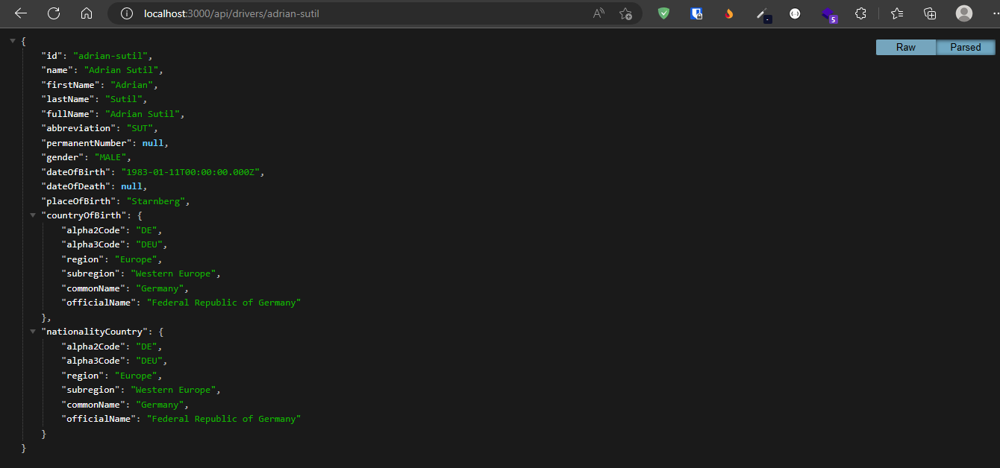
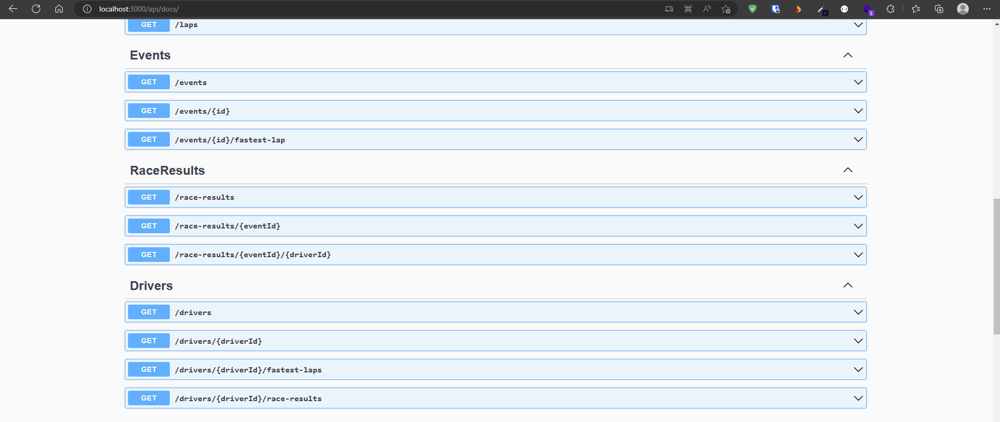

# RaceDex API 🏎️🗂️

Welcome to one of the largest open databases on Formula 1: a SQLite database and a Node.js API, ready to be used with race results, teams, lap times, pit stops, free practice and much more! It starts with Formula 1 and is designed to grow into other motorsport competitions.

Use it for your own website or app, for data analysis, for research or just for curiosity. The database is built from plain CSV files that live in this repository, so every data change is easy to review in a pull request.
<details>
  <summary>Table of contents</summary>

- [Quick start](#quick-start)
- [Scripts](#scripts)
- [Project structure](#project-structure)
- [Manage the data](#manage-the-data-️)
- [Contributing](#contributing-)
- [License](#license)

</details>

## Run the API locally 🚀

### Prerequisites

- [Node.js](https://nodejs.org/en/download/) **22 or newer**.
- A C/C++ toolchain is only needed if there is no prebuilt binary of `better-sqlite3` for your platform (rare).

### Quick start

```bash
git clone https://github.com/enrique-lozano/RaceDex-API.git
cd RaceDex-API
npm install
npm run dev
```

That's it. On the first run the SQLite database is created automatically from the CSV files (it takes a few seconds). Then try <http://localhost:3200/api/drivers/sutil> in your browser:



All the endpoints are documented with Swagger at <http://localhost:3200/api/docs>:



> The content you see may differ from what is shown in the screenshots.

CORS is enabled for any origin (`GET`, `HEAD` and `OPTIONS` requests), so the API can be consumed directly from the browser by any website.

### Translated content

Country names are not stored in the database: they are translated on the fly with the ICU data of Node.js. Add `?locale=es` (any [BCP 47](https://www.rfc-editor.org/info/bcp47) tag) to a request to get them in another language, e.g. <http://localhost:3200/api/countries/ES?locale=es>. The default is `en`.

### Scripts

| Script                               | What it does                                                                                                              |
| ------------------------------------ | ------------------------------------------------------------------------------------------------------------------------- |
| `npm run dev`                        | Starts the server with auto-reload                                                                                        |
| `npm run build` / `npm start`        | Compiles to `dist/` / runs the compiled server                                                                            |
| `npm test`                           | Runs the tests (creates the database first if it does not exist)                                                          |
| `npm run lint` / `npm run typecheck` | ESLint / TypeScript checks                                                                                                |
| `npm run prettier`                   | Formats the code                                                                                                          |
| `npm run swagger`                    | Regenerates `src/routes.ts` and `src/swagger.json` from the controllers (done automatically by `dev`, `build` and `test`) |
| `npm run import-db`                  | Rebuilds the database from `data/csv`                                                                                     |
| `npm run docs:db`                    | Regenerates the database diagram (`docs/database.svg`)                                                                    |
| `npm run export-db`                  | Writes the database back to `data/csv`                                                                                    |

Configuration (optional environment variables): `PORT` (default `3200`), `RACEDEX_DB_PATH` (default `data/db/racedex.db`) and `RACEDEX_DATA_DIR` (default `data`).

### Files that are generated

These are not stored in git, they are created for you when needed:

- `data/db/racedex.db`: the database. Created on the first start, or with `npm run import-db`.
- `src/routes.ts` and `src/swagger.json`: generated by [tsoa](https://tsoa-community.github.io/docs/) from the controllers.
- `dist/`: compiled code.

## Project structure

```
src/             API code (controllers, services, models). Each module = one resource
data/            Database: schema, CSV files (source of truth) and import/export scripts
generators/      Python scripts used to fetch/update data (results, laps, pit stops...)
docs/            Contribution guides
```

## Manage the data 🗂️

The CSV files in [`data/csv`](data) are the source of truth. See the [data README](data/README.md) to learn how they are organised and how to edit them.

## Contributing 🙋🏻

Contributions are very welcome, from fixing a wrong lap time to adding new features. Read the [contributing guidelines](CONTRIBUTING.md) to get started.

## License

- **Code**: [GNU AGPL v3](LICENSE).
- **Data**: [CC BY-NC-SA 4.0](DATA_LICENSE.md). The data is compiled from several sources; see [DATA_LICENSE.md](DATA_LICENSE.md) for the details and the attribution you must give when reusing it.
