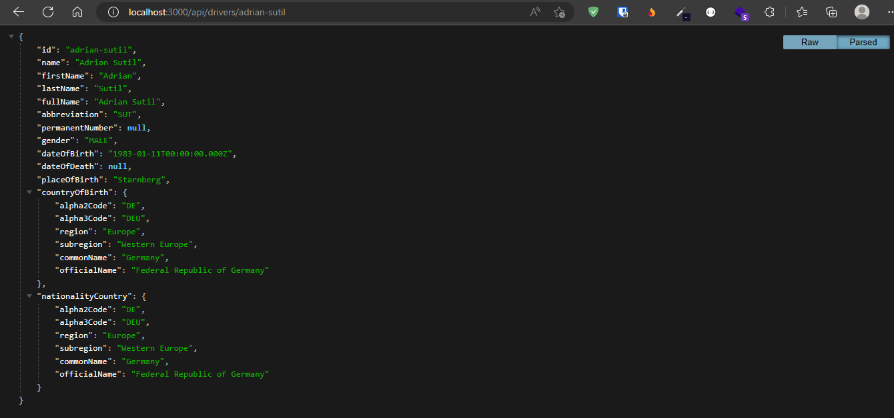
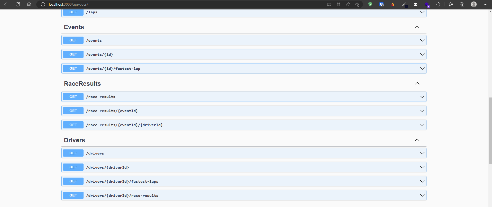

# RaceDex 🏎️🗂️

**Every Formula 1 Grand Prix since 1950, as open data.** 74 seasons, 1,101 races, around 560,000 lap times, 20,000 pit stops, 900 drivers and the full story of the teams, engines and chassis behind them. Free to use through a REST API, a SQLite database or plain CSV files.

Use it for your own website or app, for data analysis, for research or just for curiosity. It starts with Formula 1 and is designed to grow into other motorsport competitions.

<details>
  <summary>Table of contents</summary>

- [The data in numbers](#the-data-in-numbers-)
- [What's inside](#whats-inside-)
- [How complete is it?](#how-complete-is-it-)
- [How the data is built](#how-the-data-is-built-)
- [Run the API locally](#run-the-api-locally-)
- [Try it](#try-it-)
- [Contributing](#contributing-)
- [License](#license)

</details>

## The data in numbers 📊

|                          |                  |
| ------------------------ | ---------------- |
| Seasons                  | 74 (1950–2023)   |
| Grands Prix              | 1,101            |
| Sessions                 | 5,649            |
| Race result rows         | ~114,000         |
| Lap times                | ~560,000         |
| Pit stops                | ~20,000          |
| Drivers                  | 900              |
| Teams (entrants)         | 633              |
| Constructors             | 184              |
| Circuits                 | 76               |
| Safety cars / red flags  | 305 / 88         |

## What's inside 🔎

- **Results** of every race, qualifying and practice session, with the status of each driver, including the ones that never took the start (did not qualify, withdrawn, excluded...) and the reason for each retirement.
- **Lap times and pit stops**, lap by lap, for the modern era (see the coverage below).
- **Race control events**: safety cars and red flags.
- **Teams done right**: a team keeps its identity through sales and renames, and the chassis constructor and the engine manufacturer are tracked separately. A team can race the chassis of another constructor, and an engine can be rebadged under another brand.
- **Drivers**, their nationalities, test drivers and the family relationships between them.
- **Championships**, with the Constructors' standings calculated from the race results.
- **Circuits, Grands Prix, tyre manufacturers** and more. See the [database diagram](data/README.md#database-diagram) for the complete picture.

## How complete is it? ✅

The data is not equally detailed for every era: some sessions did not exist in the past, and lap times and pit stops were not recorded until much later. This is what we have:

| Period | Races | Race results | Qualifying | Practice | Lap times | Pit stops |
| ------ | ----- | ------------ | ---------- | -------- | --------- | --------- |
| 1950s  | 84    | 🟢 100%      | 🟢 100%    | ⚪ 0%    | ⚪ 0%     | ⚪ 0%     |
| 1960s  | 100   | 🟢 100%      | 🟢 100%    | ⚪ 0%    | ⚪ 0%     | ⚪ 0%     |
| 1970s  | 144   | 🟢 100%      | 🟢 100%    | ⚪ 0%    | ⚪ 0%     | ⚪ 0%     |
| 1980s  | 156   | 🟢 100%      | 🟢 100%    | 🟠 22%   | ⚪ 0%     | ⚪ 0%     |
| 1990s  | 162   | 🟢 100%      | 🟢 100%    | 🟢 100%  | 🟠 40%    | 🟡 59%    |
| 2000s  | 174   | 🟢 100%      | 🟡 93%     | 🟢 100%  | 🟢 100%   | 🟢 100%   |
| 2010s  | 198   | 🟢 100%      | 🟢 100%    | 🟢 100%  | 🟢 100%   | 🟢 100%   |
| 2020s  | 83    | 🟢 100%      | 🟢 100%    | 🟢 100%  | 🟢 100%   | 🟢 98%    |

🟢 complete (≥95%) · 🟡 mostly (≥50%) · 🟠 partial · ⚪ none. The percentage is the share of Grands Prix of the period that have that kind of data. The full report, season by season, is in [data/COVERAGE.md](data/COVERAGE.md).

## How the data is built 🛠️

All our data has been entered and validated manually from several sources, which are listed [here](data/SOURCES.md). It is stored as plain CSV files in this repository, which are the source of truth, so every data change is easy to review in a pull request. The SQLite database that the API reads is built from them automatically. Read the [data README](data/README.md) to learn how the files are organised and how to edit them.

Spotted a wrong lap time or a missing result? You can fix it by editing a CSV file, no programming needed. See [Contributing](#contributing-).

## Run the API locally 🚀

### Prerequisites

- [Node.js](https://nodejs.org/en/download/) **22 or newer**.
- A C/C++ toolchain is only needed if there is no prebuilt binary of `better-sqlite3` for your platform (rare).

### Quick start

```bash
git clone https://github.com/enrique-lozano/RaceDex-API.git
cd RaceDex-API
npm install
npm run dev
```

That's it. On the first run the SQLite database is created automatically from the CSV files (it takes a few seconds).

Configuration (optional environment variables): `PORT` (default `3200`), `RACEDEX_DB_PATH` (default `data/db/racedex.db`) and `RACEDEX_DATA_DIR` (default `data`). The rest of the scripts and the project structure are described in the [code contributing guide](docs/CODE_CONTRIBUTING.md#project-reference).

## Try it 🧪

Open <http://localhost:3200/api/drivers/sutil> in your browser:



All the endpoints are documented with Swagger at <http://localhost:3200/api/docs>:



> The content you see may differ from what is shown in the screenshots.

Some things you can ask:

| Question                                         | Request                                         |
| ------------------------------------------------ | ----------------------------------------------- |
| Who set the fastest lap in the 2023 Bahrain GP?  | `GET /api/sessions/2023/1/R/fastest-lap`        |
| How long did the pit stops of that race take?    | `GET /api/sessions/2023/1/R/pit-stops`          |
| Every lap of the race, driver by driver          | `GET /api/sessions/2023/1/R/laps`               |

For instance, the first one answers (trimmed) that the fastest lap was Zhou Guanyu's, on lap 56 with a time of 93,996 ms (1:33.996):

```json
{
  "position": 16,
  "lap": 56,
  "time": 93996,
  "entry": {
    "id": "2023-ZHO",
    "entrantName": "Alfa Romeo F1 Team ORLEN",
    "driver": { "id": "zhou", "name": "Guanyu Zhou" }
  }
}
```

Times are in milliseconds. Results are paginated (`pageSize`, `currentPage`).

### Good to know

- CORS is enabled for any origin (`GET`, `HEAD` and `OPTIONS` requests), so the API can be consumed directly from the browser by any website.
- Country names are not stored in the database: they are translated on the fly with the ICU data of Node.js. Add `?locale=es` (any [BCP 47](https://www.rfc-editor.org/info/bcp47) tag) to a request to get them in another language, e.g. <http://localhost:3200/api/countries/ES?locale=es>. The default is `en`.

## Contributing 🙋🏻

Contributions are very welcome, from fixing a wrong lap time to adding new features. Read the [contributing guidelines](CONTRIBUTING.md) to get started.

## License

- **Code**: [GNU AGPL v3](LICENSE).
- **Data**: [CC BY-NC-SA 4.0](DATA_LICENSE.md). The data is compiled from several sources; see [DATA_LICENSE.md](DATA_LICENSE.md) for the details and the attribution you must give when reusing it.
