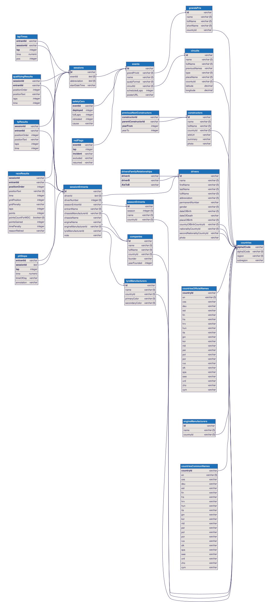

# RaceDex database

This directory is the hub of the API data. The data exists in two forms:

| Form      | Location        | In git? | Purpose                              |
| --------- | --------------- | ------- | ------------------------------------ |
| CSV files | `csv/`          | ✅ Yes  | Source of truth, easy to review/diff |
| SQLite DB | `db/racedex.db` | ❌ No   | What the API actually reads          |

The data is licensed under [CC BY-NC-SA 4.0](../DATA_LICENSE.md).

## CSV files

Files in `csv/` can be edited with any spreadsheet program (LibreOffice is recommended over Excel, which tends to alter encodings and date formats).

- One file per table (`drivers.csv`, `circuits.csv`, ...) in the root of `csv/`.
- Tables with many rows are split **per session** in
  `csv/seasons/<year>/<round> - <GP name>/<session> - <Results|Lap times|Pit stops>.csv`.
  The `sessionId` column is not stored in those files: it is deduced from the path (`2023-01-R`).

After editing the CSV files, rebuild the database to see the changes in the API:

```bash
npm run import-db
```

The import is atomic: the database is built in a temporary file and replaces the real one only if everything succeeded, so a mistake in a CSV never leaves you with a broken database.

## The database

`db/racedex.db` does not exist in a fresh clone. It is created automatically the first time you start the server (or run the tests), or manually with `npm run import-db`. The structure is defined in [`schema.sql`](schema.sql).

If you modify the database directly (for example with [SQLite Studio](https://sqlitestudio.pl/)), export your changes back to CSV, since the database is not stored in git:

```bash
npm run export-db
```

The export only rewrites the files whose content actually changed, so `git status` shows exactly what you modified.

## Database diagram



The diagram ([`docs/database.svg`](../docs/database.svg)) and its source ([`docs/database.dbml`](../docs/database.dbml)) are generated from the database. Regenerate them after changing `schema.sql`:

```bash
npm run import-db && npm run docs:db
```

The `.dbml` file can also be pasted into [dbdiagram.io](https://dbdiagram.io) to explore or publish it.

## Notes for maintainers

- The order of the tables in [`constants.ts`](constants.ts) matters: parents must come before the tables that reference them.
- The import disables foreign keys while loading and runs a `foreign_key_check` at the end, printing a warning if some row references a missing parent.
- Indexes live in [`indexes.sql`](indexes.sql) and are created after the rows are loaded. When adding a table or a foreign key, add its index there.
- Foreign key columns must use the same type and `COLLATE` as the column they reference, otherwise SQLite cannot use their index in joins.
- Both commands are around 5s (import) and 2s (export) for ~700k rows.

Before sending a data change, read the [contributing guidelines](../CONTRIBUTING.md).
