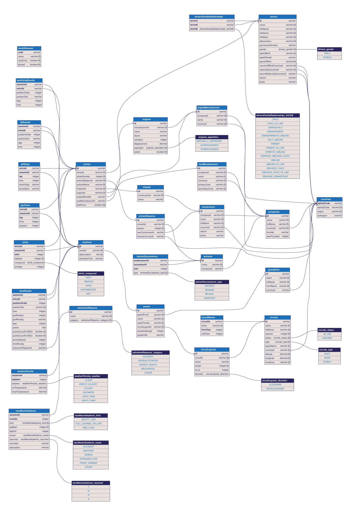

# RaceDex database

This directory is the hub of the API data. The data exists in two forms:

| Form      | Location        | In git? | Purpose                              |
| --------- | --------------- | ------- | ------------------------------------ |
| CSV files | `csv/`          | ✅ Yes  | Source of truth, easy to review/diff |
| SQLite DB | `db/racedex.db` | ❌ No   | What the API actually reads          |

The data is licensed under [CC BY-NC-SA 4.0](../DATA_LICENSE.md).

## CSV files

Files in `csv/` can be edited with any spreadsheet program (LibreOffice is recommended over Excel, which tends to alter encodings and date formats).

- One file per table (`drivers.csv`, `circuits.csv`, ...) in the root of `csv/`.
- Tables with many rows are split **per session** in
  `csv/seasons/<year>/<round> - <GP name>/<session> - <Results|Lap times|Pit stops|Stints>.csv`.
  The `sessionId` column is not stored in those files: it is deduced from the path (`2023-01-R`).

After editing the CSV files, rebuild the database to see the changes in the API:

```bash
npm run import-db
```

The import is atomic: the database is built in a temporary file and replaces the real one only if everything succeeded, so a mistake in a CSV never leaves you with a broken database.

## Circuits and layouts

A circuit (`circuits.csv`) is the venue; each of its configurations is a layout (`circuitLayouts.csv`), and every event points to the layout that was raced (`events.circuitLayoutId`). A new layout is needed when the race lap changes, that is, its length or its sequence of corners: a new chicane, a shortened lap, an oval versus the road course. Changes of kerbs, asphalt or corner names are not new layouts. A layout that comes back after some years is the same row.

The length is a hint, not the test: a few metres of difference between sources is not a new layout, and two consecutive layouts can have the same length and corners (Zandvoort 1973-78 and 1979). The cases that are decided, and the ones that are not, are in [ADR 0001](../docs/adr/0001-circuit-layouts.md).

The layout `id` is `<circuitId>-<first season it was used>` (`silverstone-2010`), and `name` is only filled when the layout is known by one (`Nordschleife`). `length` is in metres. The import fails if a layout has no events, and warns if its id does not have the first season it was raced.

## Track shapes

The shape of a layout is optional and lives in `tracks/<circuitLayoutId>.geojson` (see [ADR 0002](../docs/adr/0002-track-geometry-as-geojson-files.md)); GitHub draws it as a map. Each file is a `FeatureCollection` of WGS84 `[longitude, latitude]` points with:

- exactly one `Feature` with `properties.kind: "track"`: a closed `LineString`, in the direction of the race when the layout has a `direction`;
- optionally, one `Feature` with `properties.kind: "pit-lane"`: a `LineString` from the pit entry to the pit exit;
- optionally, the ends of the sectors 1 and 2: one `Feature` each with `properties.kind: "sector"`, `sector: 1` or `2`, and a `Point` on the track. They are valid for every season the layout was raced; if the timing lines moved, give each point the seasons it applies to with `from` and/or `until`;
- optionally, for the layouts raced from 1994 (when the pit speed limit started), `pit-limit-start` and `pit-limit-end`: a `Point` each, on the pit lane, where the speed limit begins and ends;
- optionally, the corners: one `Feature` each with `properties.kind: "corner"`, a `number` (as in the official track map) and, if it has one, a `name`, and a `Point` on the apex of the corner.

The first point of the `track` is the start line only when its `properties` say `"startLine": true`; then the import derives the distances of the corners and of the sectors from it along the track, in the direction of the race (tables `circuitLayoutCorners` and `circuitLayoutSectors`, not CSV files), and fails if one of those points is more than 20 m from the track. Sector 3 ends at the start line, so only the ends of sectors 1 and 2 are stored; the table has one row per season because the timing lines can move without the layout changing.

Keep the points sparse (a point every 30-40 m is enough, a few KB per file). `npm run import-db` loads the files into the database and fails if a file does not belong to a layout, is malformed, or if the length of its track differs more than 5% from the `length` of the layout, if the track is more than 1 km from the `latitude`/`longitude` of its circuit, or if it has corners and they are not as many as the `turns` of the layout (numbered from 1 to `turns`). The layouts still without a shape, and which to draw first, are in [`COVERAGE.md`](COVERAGE.md).

## Weather, neutralisations and stints

These tables are optional per race: a race without them keeps all its other data. Their time axis is the **leader's lap** (not the clock), so they join with `lapTimes` and `pitStops` and work for races whose only known time is the date. Lap 0 is "before the first lap".

- `weatherPeriods.csv`: the weather of a race session as ranges of laps, storing only the changes. The row with `lapStart` 1 always exists and describes the start of the race (`weather`: `CLEAR`, `PARTLY_CLOUDY`, `CLOUDY`, `SHOWERS`, `LIGHT_RAIN`, `HEAVY_RAIN`). The temperatures are optional (Celsius).
- `raceNeutralisations.csv`: every interruption of the pace of a race, ordered inside its session. `SAFETY_CAR` is a pace car that bunches the field (it covers the full-course caution of other series); `FULL_COURSE_YELLOW` is the virtual safety car and its equivalents (everybody slows down, no pace car); `RED_FLAG` stops the race. It replaces the old `redFlags.csv` and `safetyCars.csv`. `lapEnd` is the lap on which racing resumes (for a safety car, the lap after the one in which it comes in). The virtual safety cars exist only for 2022 and 2023, and the safety cars and red flags of 2023 come from the race control messages, so some `lapEnd` are empty.
- `seasons/<year>/<round> - <GP>/R - Stints.csv`: the sets of tyres of each driver: `stint`, `lapStart` (the end is the start of the next stint minus 1), `compound` (relative to the dry compounds of the weekend: `SOFT` is the softest; with two dry compounds they are `SOFT` and `HARD`) and `tyreAge` (laps already done when it started). Only loaded when the compound is known (2022 and 2023 so far).

## Sources and coverage

- [`SOURCES.md`](SOURCES.md): where the data comes from.
- [`COVERAGE.md`](COVERAGE.md): how complete each kind of data is, per decade and season. Regenerate it after adding data with `npm run docs:coverage`.

## The database

`db/racedex.db` does not exist in a fresh clone. It is created automatically the first time you start the server (or run the tests), or manually with `npm run import-db`. The structure is defined in [`schema.sql`](schema.sql).

If you modify the database directly (for example with [SQLite Studio](https://sqlitestudio.pl/)), export your changes back to CSV, since the database is not stored in git:

```bash
npm run export-db
```

The export only rewrites the files whose content actually changed, so `git status` shows exactly what you modified.

## Photos of the drivers

The `photo` column of `drivers.csv` has the URL of the image of each driver, or is empty if there is none. The images are not in this repository: they are in [racedex-assets](https://github.com/enrique-lozano/racedex-assets) and served with GitHub Pages. When they change, update the column and import the CSV files again:

```bash
npm run set-driver-photos
npm run import-db
```

The script asks GitHub which images exist. Use `npm run set-driver-photos -- --dir <path to a local copy of racedex-assets>` to read them from disk instead.

## Database diagram



The diagram ([`docs/database.svg`](../docs/database.svg)) and its source ([`docs/database.dbml`](../docs/database.dbml)) are generated from the database. Regenerate them after changing `schema.sql`:

```bash
npm run import-db && npm run docs:db
```

The `.dbml` file can also be pasted into [dbdiagram.io](https://dbdiagram.io) to explore or publish it.

## Teams, constructors, chassis and engines

- An **entrant** (`entrants`) is who registers and runs the cars: the "team". Its identity lasts for the whole history, and a sale or rename creates a new entrant linked in `entrantSuccessions`. Per-season facts (own constructor, licence nationality) are in `entrantSeasons`.
- A **constructor** (`constructors`) designs the chassis (`chassis`). A team can race the chassis of another constructor.
- An **entry** (`entries`) is a driver in a car configuration: entrant season, registered name (`entrantName`, sponsors included), chassis, engine (`engines`, with who built it) and, if the engine is rebadged, its brand (`engineBrandId`). The results of every session refer to an entry. Its id is `{season}-{ABBR}`, the season and the 3-letter abbreviation of the driver (`2023-ALO`); the car number is added when the driver used several that season or another driver of that season shares the abbreviation (`1950-CHI-47`), and a letter when the rest is still the same, e.g. another chassis (`1961-GRE-14-a`).

## Race results of the drivers that did not start

Every driver entered for a race has a row in its `R - Results.csv`, also the ones that did not take the start. `positionText` is then one of the codes of [`resultStatuses.csv`](csv/resultStatuses.csv) instead of a position: `DNS` (did not start: was due to start and did not, e.g. a failure on the way to the grid), `DNQ` (did not qualify), `DNPQ` (did not pre-qualify), `EX` (excluded), `DNP` (did not practice), `WD` (withdrawn by the team or the driver before the race, also after practice or qualifying) and `DNA` (did not arrive). They go after the drivers that took the start, in that order, and the non-qualifiers by their qualifying time. A test driver (third, reserve or Friday driver) has `testDriver` = 1 in his entry and no race row: the API gives him `TD` in those GPs.

- The Constructors' Championship is not stored: the API calculates it from the race results (`pointsCountForWCC` marks the results that do not score for it).

## Notes for maintainers

- The order of the tables in [`constants.ts`](constants.ts) matters: parents must come before the tables that reference them.
- The comments of [`schema.sql`](schema.sql) are documentation: a comment at the end of a column line is the note of that column, and the comment lines right above `DROP TABLE IF EXISTS <table>;` are the note of the table. A simple `CHECK (<column> IN ('A', 'B'))` becomes an enum. `npm run docs:db` turns all of it (plus the indexes) into `docs/database.dbml`.
- The import disables foreign keys while loading and runs a `foreign_key_check` at the end, printing a warning if some row references a missing parent.
- Indexes live in [`indexes.sql`](indexes.sql) and are created after the rows are loaded. When adding a table or a foreign key, add its index there.
- Foreign key columns must use the same type and `COLLATE` as the column they reference, otherwise SQLite cannot use their index in joins.
- Both commands are around 5s (import) and 2s (export) for ~700k rows.

Before sending a data change, read the [contributing guidelines](../CONTRIBUTING.md).
